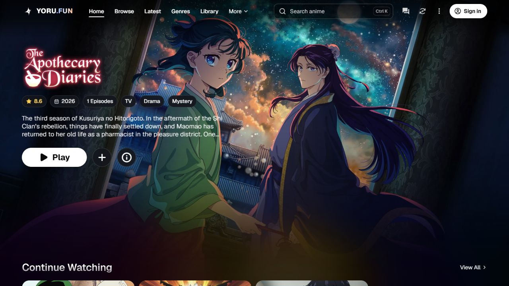
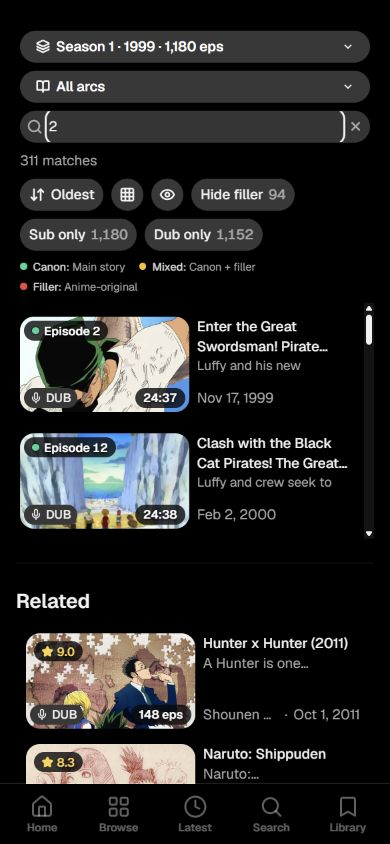
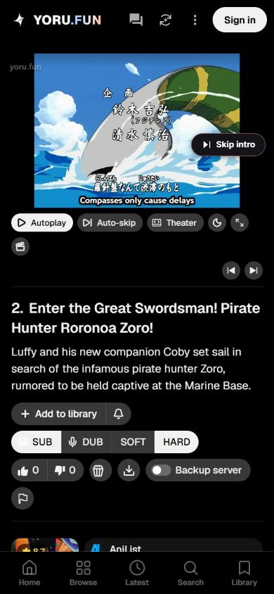

<h1>Yoru.fun</h1>

<strong>Tu próximo anime empieza aquí.</strong>

Descubre anime, guarda tu biblioteca y disfruta de una experiencia de reproducción sencilla desde tu navegador.

<a href="https://yoru.fun"><strong>Explorar Yoru.fun →</strong></a> · <a href="README.md">English</a>

## Descubre y disfruta

**Mi proyecto más grande hasta ahora.** Yoru.fun reúne descubrimiento, reproducción, biblioteca personal y comunidad en una sola web. Creado por [Owais](https://github.com/greenman9909-cmd).

- Busca títulos y explora géneros.
- Guarda tu biblioteca y continúa donde lo dejaste.
- Elige entre los idiomas de audio y subtítulos disponibles para cada episodio.
- Usa el modo cine o la pantalla completa.
- Participa en comentarios y descubre la opción de ver con amigos.

Inicia sesión para guardar tu biblioteca y progreso entre dispositivos. La disponibilidad de reproducción e idiomas varía según el título y el episodio.

## Un recorrido por Yoru.fun

### 1. Encuentra tu próximo anime

Busca títulos y explora géneros y actualizaciones. Las actualizaciones indican episodios añadidos o modificados en el catálogo; no siempre son estrenos originales.

### 2. El episodio y sus controles

Navega entre episodios, selecciona las pistas disponibles y usa reproducción automática, salto automático, modo cine o pantalla completa. Puedes buscar un número en la lista de episodios.

### 3. También en tu móvil

| Selecciona un episodio | Sigue viendo |
| --- | --- |
|  |  |

La navegación móvil mantiene Inicio, Explorar, Últimos, Buscar y Biblioteca a mano. Guarda títulos, consulta tu historial, personaliza tu perfil y participa en comentarios.

La web comienza en inglés y permite cambiar el idioma desde ajustes. El idioma de la interfaz y las pistas de audio o subtítulos son opciones distintas; estas últimas dependen de cada episodio.

## Invítame a un café

Si te gusta Yoru.fun, puedes apoyar su desarrollo. Es totalmente opcional.

## Comparte tus ideas

¿Has encontrado un problema? [Abre una incidencia](https://github.com/greenman9909-cmd/yoru-fun/issues/new) con la página pública, tu navegador y una descripción. No incluyas información personal de tu cuenta.

Este repositorio es la presentación pública y el espacio de comentarios de Yoru.fun. Las ilustraciones y los títulos de anime pertenecen a sus respectivos propietarios.
