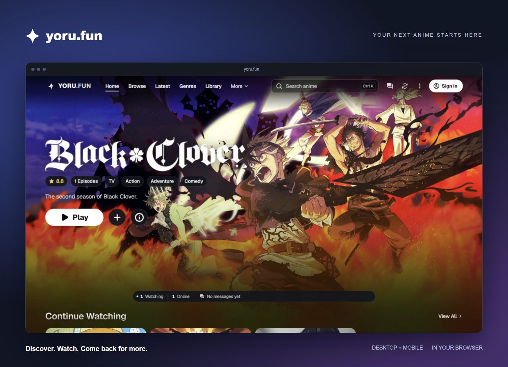
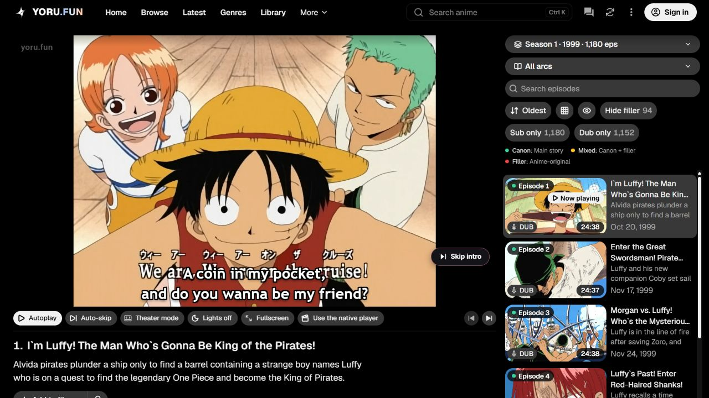

  
  <h1>Yoru.fun</h1>
  
<strong>Your next anime starts here.</strong>

  
Discover anime, build your library, and enjoy a clean viewing experience in your browser.

  
<a href="https://yoru.fun"><strong>Explore Yoru.fun →</strong></a> · <a href="#the-experience">Features</a> · <a href="https://github.com/greenman9909-cmd/yoru-fun/issues">Feedback</a> · <a href="README.es.md">Español</a>

  
  
  

  
Enjoy the project? Leave a ⭐ and share <a href="https://yoru.fun">yoru.fun</a> with a friend.

## The experience

| Explore | Make it yours | Keep watching |
| --- | --- | --- |
| Search titles and browse genres | Save titles to your library | Resume your progress |
| Discover episode updates | Choose available audio and subtitles | Use theater or fullscreen mode |
| Find something for your next session | Personalize your profile | Connect through comments and watch together |

Sign in to save your library and progress across devices. Audio, subtitles, and playback availability vary by title and episode.

## Built for the browser

Open **[yoru.fun](https://yoru.fun)** on desktop or mobile. Browse first, then sign in when you want to keep your library with you.

<strong>A closer look at the player</strong>

Episode navigation, playback controls, and viewing options together in one place.

## Feedback welcome

Found a problem or have an idea? [Open an issue](https://github.com/greenman9909-cmd/yoru-fun/issues/new). Include the public page address, your browser, and what you expected to happen. Please leave out personal account information.

This repository is the public showcase and feedback hub for Yoru.fun.

## Credits

Anime artwork and titles belong to their respective owners. Screenshots show the Yoru.fun interface; catalogue content and availability can change.
